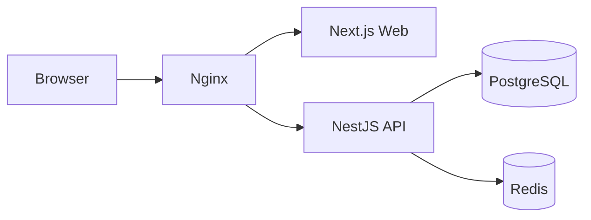
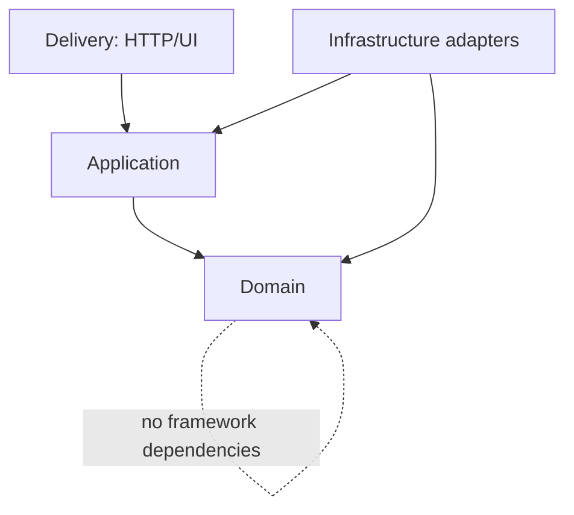

# Sprint 1 Foundation

## Scope

Sprint 1 establishes the executable platform boundary. It intentionally delivers infrastructure, security, persistence, observability primitives, shared contracts, and a branded web shell before domain modules are implemented.

## Runtime topology

## Module dependency rule

The current sprint implements the delivery and infrastructure foundation. Subsequent modules must preserve this dependency direction.

## API conventions

- Base path: `/api/v1`
- JSON request and response bodies
- RFC 9457-style problem details for failures
- `x-request-id` propagated through logs and responses
- URI versioning through NestJS
- OpenAPI available only when explicitly enabled

## Security baseline

- Helmet and explicit web security headers
- strict CORS allow-list
- per-process rate limiting
- HMAC-protected double-submit CSRF tokens
- secure cookie policy controlled by validated environment values
- structured redacted logs
- no stack traces in responses
- non-root runtime containers
- health endpoints split into liveness and dependency readiness
